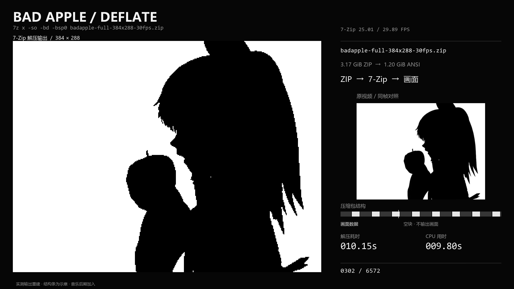

# badapple.7z

**Bad Apple，但播放器是原装 7-Zip。**

给原装解压器一个标准 ZIP，让它把内容直接输出到终端，Bad Apple 就会一帧帧显示出来。播放时只运行一次解压命令；画面停留的时间来自压缩数据中的空 DEFLATE 块。



上图直接截自主视频。演出界面根据实际解压输出与到达时间制作，原视频对照、说明面板及配乐在后期加入。下载的播放包只输出终端字符画，不包含音频或这个演出界面。

## 先跑起来

需要 Windows 10/11、系统自带的 Windows PowerShell 5.1，以及[原版 7-Zip](https://www.7-zip.org/)。**播放不需要 Python、FFmpeg、Node.js 或修改后的解压器。**

1. 从 [Releases](https://github.com/cr3atL/badapple.7z/releases/latest) 下载 `badapple.7z-runtime-v1.0.0.zip`，解压到普通目录；也可以直接下载本仓库源码。
2. 安装 7-Zip，推荐使用默认安装位置。
3. 在项目目录打开 PowerShell，先下载三秒小样：

```powershell
powershell -NoProfile -ExecutionPolicy Bypass -File tools\download-assets.ps1 -Preset demo
.\play-demo.cmd
```

确认能看到动画后，下载完整版：

```powershell
powershell -NoProfile -ExecutionPolicy Bypass -File tools\download-assets.ps1 -Preset full
.\play-full.cmd
```

下载脚本会校验下载包的 SHA-256，用原装 7-Zip 还原其中的播放 ZIP，再校验原 ZIP。完整版下载约 **8.4 MiB**，还原后约 **3.17 GiB**，建议预留 **4 GiB** 空间。实际播放时不需要把 ZIP 里的字符文件解压到磁盘。

这里有两步：外层 `.playback.7z` 只是为了方便下载；准备完成后，真正负责播放的是里面的标准 ZIP。外层压缩不会改变播放 ZIP 的任何字节。

完整版有 384 列、144 行字符，需要较小的终端字体。启动器会在经典控制台中尝试配置 Consolas 和窗口大小；Windows Terminal 的兼容接口可能忽略字体设置。如果提示无法容纳，在 Windows Terminal 中用 `Ctrl` + 鼠标滚轮缩小字体，直到至少 384 列、144 行，然后在项目目录运行：

```powershell
powershell -NoProfile -ExecutionPolicy Bypass -File tools\play.ps1 -Preset full -UseCurrentTerminal
```

这一模式保留你当前的终端尺寸和字号，只启用 UTF-8、VT 并启动原装解压器。可先用 `[Console]::WindowWidth; [Console]::WindowHeight` 查看当前列数和行数。先用 64×48 的三秒版确认环境。

## 下载内容

| 版本 | 图像与帧数 | 下载大小 | 还原后的 ZIP | 用途 |
| --- | --- | --- | --- | --- |
| `full` | 384×288，6,572 帧 | 8,776,064 B | 3,403,822,975 B | 完整 MV，目标约 30 fps |
| `demo` | 64×48，72 帧 | 15,269 B | 34,689,471 B | 三秒小样，目标 24 fps |
| `count-paced` | 24×20，3 帧 | 4,809 B | 27,196,791 B | 带空块的“数到 3” |
| `count-fast` | 相同的 3 帧 | 581 B | 196,791 B | 无空块对照 |

```powershell
powershell -NoProfile -ExecutionPolicy Bypass -File tools\download-assets.ps1 -Preset comparison
.\play-count-paced.cmd
.\play-count-fast.cmd
```

也可用 `-Preset all` 下载全部版本。

也可以把 Release 中的 `.playback.7z` 文件手动下载到 `downloads/`，再离线准备：

```powershell
powershell -NoProfile -ExecutionPolicy Bypass -File tools\download-assets.ps1 -Preset full -Offline
```

## 实际执行的命令

在已开启 UTF-8、VT/ANSI 输出且尺寸足够的终端中，可以直接运行：

```powershell
& 'C:\Program Files\7-Zip\7z.exe' x -so -bd -bsp0 .\samples\badapple-full-384x288-30fps.zip
```

`-so` 把解压内容输出到标准输出。启动器只在进程开始前设置终端，然后启动这条命令并等待它结束。退出后的按键提示不参与播放。不要把命令输出接入 PowerShell 的文本处理管道。

7-Zip 安装在其他位置时，可设置：

```powershell
$env:SEVENZIP_BINARY='D:\Apps\7-Zip\7z.exe'
.\play-full.cmd
```

Linux/macOS 可在已配置好的兼容终端中运行 `7zz x -so -bd -bsp0 samples/badapple-full-384x288-30fps.zip`。自动配置启动器仅支持 Windows；其他平台没有进行同等的终端实测。

## 为什么解压能播放动画

1. 原视频拆帧、缩小并二值化。空格、上半块 `▀`、下半块 `▄`、整块 `█` 表示上下两个黑白像素。
2. 所有帧按顺序写入同一个 `badapple.ansi`。每帧前面的 `ESC[H` 让光标回到左上角，下一帧覆盖上一帧。
3. 字符数据放在 DEFLATE 存储块中；NUL 填充让解压器的输出缓冲及时写出。
4. 两帧的数据块之间，插入大量合法的空动态霍夫曼块。解压器建立解码表、遇到块结束符，然后继续处理下一个空块；这段工作消耗时间，却不输出新字符。

因此，终端在解压器处理空块时保持上一帧，下一帧字符到达后才更新。每四个空块组成一个 45 字节的对齐组；完整版每帧使用 7,140 组，即 **28,560 个空块**，字符输出包最少 196,608 字节。格式依据 [RFC 1951](https://www.rfc-editor.org/rfc/rfc1951#section-3.2.7)。

ZIP 里只有一个普通 ANSI 数据文件，压缩方法为标准 DEFLATE。空块刻意增加了解码工作和文件大小，所以本项目的 ZIP 会比解压后的字符数据还大。

## 速度与验证

原装 7-Zip 25.01 的一次本机观测中，完整版用时 **219.923 秒**，标记平均到达速率约 **29.887 fps**，6,572 帧连续且图像与参考一致。“数到 3”有空块版本用时 2.736 秒，无空块版本约 0.020 秒，输出字节完全相同。摘要见 [docs/measurements.json](docs/measurements.json)。

空块消耗的是计算时间，**不是跨机器恒定的计时器**。CPU、系统负载、解压器版本、终端绘制开销都会影响实际播放速度。管道中观测的帧标记到达时间，也不等于屏幕绘制完成时间。

可选的被动验证工具只需要 Python 3.11+ 标准库和原装 7-Zip，不保存庞大的 stdout 文件：

```powershell
python tools\verify_archive.py samples\badapple-3s-24fps.zip --report verification\demo.json
```

它核对退出码、ZIP 内 CRC、输出长度、连续帧编号，以及元数据中可用的输出 SHA-256。完整版执行相同检查时，会完整解压一遍。该工具只读取和统计输出，不控制帧率。

## 自己生成播放包

这一部分才需要 Python 3.11+、NumPy 和 FFmpeg。优先使用 `FFMPEG_BINARY` 环境变量，其次查找 PATH 中的 `ffmpeg`；都没有时使用 `imageio-ffmpeg` 提供的程序。

```powershell
python -m pip install -r requirements-build.txt
```

建立 `assets` 目录，把输入视频放在 `assets/BadApple.source.mp4`，然后生成三秒版：

```powershell
python tools\build_demo.py --name my-demo --width 64 --height 48 --start 30 --seconds 3 --fps 24 --burn 9250 --pad 65536
```

生成与当前完整版相同参数的播放包：

```powershell
python tools\build_long_demo.py --name my-full --width 384 --height 288 --start 0 --seconds 219.066666666667 --fps 30 --burn 7140 --pad 196608
```

`--burn` 是每帧的四空块组数，越大通常停留越久。`--pad` 是每帧最小输出字节数。输入帧率、尺寸、缩放和二值化结果会影响生成内容；给其他机器校准速度时，可以先缩短 `--seconds` 做测试。

长版生成器以流式写入 ZIP，同时生成校验元数据和紧凑的 `.mono` 帧参考。默认不保存约 1.20 GiB 的未压缩 ANSI；加 `--keep-ansi` 才会额外保存。生成后的播放仍由原装 7-Zip 完成。

原始输入视频、配乐、字幕和视频制作环境不属于运行依赖，未随源码打包。MV 参考来源：[BadApple.mp4](https://github.com/rkk-2s/bad-apple/blob/master/BadApple.mp4)；音乐与影绘 MV：[Alstroemeria Records — Bad Apple!! feat. nomico](https://www.youtube.com/watch?v=i41KoE0iMYU)。作品权利归原作者。

## 文件结构

```text
play-full.cmd / play-demo.cmd       原装解压播放入口
play-count-*.cmd                    有无空块对照入口
asset-manifest.json                Release 下载地址、下载包及原始 ZIP 校验值
tools/play.ps1                     播放前的终端配置与单次原装进程启动
tools/download-assets.ps1          下载、还原播放 ZIP 与 SHA-256 校验
tools/build_demo.py                短样生成与 DEFLATE 基础结构
tools/build_long_demo.py           流式长版生成
tools/tool_paths.py                FFmpeg 路径发现
tools/verify_archive.py            被动观测与输出校验
samples/*.json                     播放包元数据
docs/                              真实主视频截图与实测摘要
```
